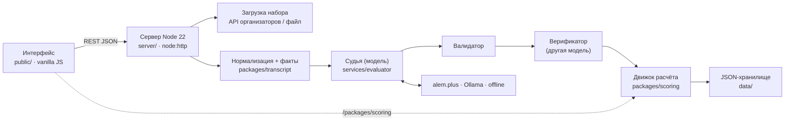

# Revengers CQA — Conversation Quality Analytics

[](https://github.com/duisek/Revengers-Data-Challenge/actions/workflows/ci.yml)


[](LICENSE)

Автоматическая, **объяснимая** и **оспариваемая** оценка качества диалогов поддержки по настраиваемому чек-листу. Прототип для NU Data Challenge × Freedom Broker (кейс «Conversation Quality Analytics»). RU · KZ · EN, чаты и звонки.

> Каждый балл — аргумент: правило чек-листа, реплики-доказательства, проверенный участок, уверенность. Его можно оспорить, проверяющий решает, система пересчитывает — и согласие с человеком измерено, а не обещано.

[English section below](#english)

<!-- TODO(team): capture docs/img/demo.gif (full 5-minute click path) and the screenshots listed in docs/img/README.md; uncomment when the files exist.

-->

---

## Содержание

1. [Что это](#что-это)
2. [Быстрый старт](#быстрый-старт)
3. [Как пользоваться](#как-пользоваться)
4. [Архитектура](#архитектура)
5. [Модели и стоимость](#модели-и-стоимость)
6. [Калибровка](#калибровка)
7. [Тесты и CI](#тесты-и-ci)
8. [Безопасность](#безопасность)
9. [Dynamics 365](#dynamics-365)
10. [Ограничения](#ограничения)
11. [Команда и лицензия](#команда-и-лицензия)

## Что это

| Контур | Что умеет |
|---|---|
| **Чек-лист** | Редактор критериев: текст, секция, вес, тип ответа (Да/Нет · Да/Нет/N/A · шкала со ступенями · флаг без баллов), доступность и условие N/A, подсказки модели по критерию и по каждому ответу. Шаблоны. **Версии** (сохранить, активировать, diff, восстановить), **замена критерия**, **симуляция** черновика на N диалогах без записи. Новый критерий применяется через настройки, без кода. |
| **Оценка** | Загрузка набора по `group_id` через API организаторов (с кэшем), загрузка/вставка JSON того же формата. Оценка одного диалога или всех — с прогрессом, отменой, возобновлением. Оценивается **только оператор**; бот и системные события — контекст. |
| **Результат** | По критерию: ответ, баллы, вес и **эффективный вес** после перераспределения, объяснение на русском, реплики-доказательства с цитатой и ссылкой, **проверенный участок** для «Нет», **причина N/A**, применённое правило, уверенность. Итог, секции, флаг грубой ошибки с типом. Модель, версия промпта, задержка. |
| **Карточка** | Транскрипт и результат рядом; клик по доказательству подсвечивает реплику; для звонков — перемотка аудио. Deep link `#/c/<id>/l/<строка>`. Переключатель версий чек-листа. |
| **Апелляция** | Оператор оспаривает критерий с комментарием → статус «под апелляцией» везде, исходная оценка видна. Проверяющий видит спор, доказательства, фрагмент; опционально — нейтральное «второе мнение» модели. |
| **Решение** | Подтвердить/изменить с причиной; четыре исхода (балл изменён · критерий нужно менять · верно, пробел в объяснении · верно, коучинг). Пересчёт общим движком; история «исходная → решение → финал». Спорные оценки исключены из рейтингов. |
| **Калибровка** | Согласие модели с человеческими метками на 65 DEV-диалогах: κ по критериям с 95 % ДИ, матрицы ошибок, расхождения со ссылками, тест–ретест. Решения проверяющего становятся примерами для модели — эффект измеряется. |
| **Инсайты** | Распределение итогов, доля провалов по критерию, язык/канал, удержание ботом и эскалации, время первой реакции, удержание в звонках, список грубых ошибок, карточка коучинга оператора. Экспорт CSV. |

Формула — из чек-листа организаторов, один в один: Да = полный вес, Нет = 0, шкала пропорционально; N/A исключается, веса перераспределяются; округление до двух знаков точной арифметикой (`60.5 / 80 → 75.63`); грубая ошибка — отдельный флаг, итог не меняет. Подробно — [docs/SCORING_POLICY.md](docs/SCORING_POLICY.md).

## Быстрый старт

Нужны Node.js ≥ 22.5 и git. Внешних npm-зависимостей **нет** — `npm install` ничего не скачивает.

```bash
git clone https://github.com/duisek/Revengers-Data-Challenge.git
cd Revengers-Data-Challenge
npm install            # зависимостей нет; команда для привычки, завершается мгновенно
cp .env.example .env   # при необходимости отредактируйте (см. ниже)
npm start              # → http://localhost:8080
```

Откройте <http://localhost:8080>.

**Модель-судья.** Без настройки система работает в режиме `offline`: показывает уже сохранённые и закоммиченные результаты DEV-набора (кэш в `data/cache/`). Для живой оценки — один из бесплатных вариантов:

- **alem.plus** (предпочтительно): заполните в `.env` `ALEM_BASE_URL`, `ALEM_API_KEY` и идентификаторы моделей `ALEM_MODEL_*` из списка моделей платформы.
- **Локально через Ollama** (данные не покидают машину):
  ```bash
  ollama pull qwen2.5:7b     # один раз
  ollama serve               # если не запущен как сервис
  ```
  Остальное уже в `.env.example` (`OLLAMA_BASE_URL`, `OPENAI_MODEL=qwen2.5:7b`).

`CQA_PROVIDER` пустой = автоматически alem → ollama → offline. Платные облачные провайдеры заблокированы (`CQA_ALLOW_CLOUD=0`). Все переменные с комментариями — в [.env.example](.env.example).

Проверить: `npm test` (все тесты зелёные), `curl http://localhost:8080/api/health`.

## Как пользоваться

### Загрузить набор (DEV / контрольный)
«Диалоги» → **«Загрузить набор»** → `group_id` (`DEV` или контрольный от организаторов) → данные приходят через сервер (CORS) и кэшируются в `data/raw/<group_id>.json`. Альтернативы: **«Загрузить файл»** / вставить JSON в формате API. Из командной строки:

```bash
curl -X POST localhost:8080/api/datasets/fetch -H 'Content-Type: application/json' -d '{"group_id":"DEV"}'
```

### Оценить
Карточка → **«Оценить»**, или «Диалоги» → **«Оценить все»** (прогресс, отмена, возобновление; частичные результаты видны сразу). CLI: `npm run evaluate -- --group DEV`.

### Прочитать результат
Карточка `#/c/<id>`: слева транскрипт с номерами строк, справа итог, секции и критерии. «Доказательство» → подсветка строки (для звонка — перемотка аудио). «Проверенный участок» у «Нет», причина у N/A, «Правило», уверенность. Ссылку на строку можно скопировать: `#/c/p1-ru-003/l/14`.

### Оспорить и решить
Роль **«Оператор»** → критерий → **«Оспорить»** → комментарий. Роль **«Проверяющий»** → `#/appeals` → очередь (открытые, затем по уверенности) → **Подтвердить / Изменить** + исход + причина → итог пересчитан, история в карточке. Подробно — [docs/APPEALS.md](docs/APPEALS.md).

### Изменить чек-лист, симуляция, версии, замена критерия
`#/checklist`: редактировать/добавить критерий или взять шаблон → **«Симуляция на N диалогах»** (без записи) → **«Сохранить версию»** → **«Активировать»** → **«Применить к выбранным»**: модель вызывается только для изменённых критериев (кэш по критерию), остальные берутся из кэша. **«Заменить критерий»** — сценарий контрольной проверки организаторов. **diff** между версиями, **восстановить** любую. В карточке — переключатель версий.

## Архитектура



Один процесс, JSON-файлы, общий движок расчёта в браузере и на сервере, кэш судьи по критерию, версии чек-листа, симуляция, фоновые задания. Подробно — [docs/ARCHITECTURE.md](docs/ARCHITECTURE.md); схемы данных — [schemas/](schemas/).

## Модели и стоимость

| Роль | Модель по умолчанию | Переменная |
|---|---|---|
| Судья | alem.plus, семейство Qwen 3.8 | `ALEM_MODEL_JUDGE` |
| Верификатор (другое семейство) | alem.plus, GPT-OSS или Gemma 4 | `ALEM_MODEL_VERIFIER` |
| Казахское второе мнение | alem.plus, KazLLM | `ALEM_MODEL_KZ` |
| Запасной | alem.plus, AlemLLM | `ALEM_MODEL_FALLBACK` |
| Локальный резерв | Ollama `qwen2.5:7b` | `OLLAMA_BASE_URL` |
| Платные облачные (заблокированы) | `claude-sonnet-5-5` / `claude-haiku-5-5` | `CQA_ALLOW_CLOUD=1` |

**Стоимость одной оценки: 0 ₸** — бесплатный API alem.plus (судья + верификатор + KazLLM для казахского) либо локальная модель. Измеренные задержка и токены на диалог, а также расчёт «если бы это был платный провайдер» (явно помеченная оценка, не факт) — в [docs/COST.md](docs/COST.md). Температура 0, модель и версия промпта записаны в каждом результате.

## Калибровка

```bash
npm run calibrate      # сравнивает оценки модели с человеческими метками tests/gold/dev_labels.json
```

Отчёт — [reports/calibration.md](reports/calibration.md) (и `reports/calibration.json` для страницы `#/calibration`): κ по критериям с 95 % ДИ на отложенной выборке, accuracy, матрицы ошибок, полнота/точность по грубым ошибкам, тест–ретест, список расхождений со ссылками на диалоги, эффект цикла обучения. Человеческие метки используются **только** для калибровки, никогда — в логике продукта.

## Тесты и CI

```bash
npm test               # node --test: движок расчёта (вектор 75.63, все 65 gold-диалогов), нормализация и факты,
                       # схемы, сборка D365, аудит репозитория, сервер, оценщик
npm run audit          # scripts/audit-repo.sh — секреты и пути перед push
npm run build:d365     # dist/d365/cqa.html
```

CI (GitHub Actions, Node 22): тесты → аудит → сборка D365. Статус — бейдж вверху.

## Безопасность

Маски персональных данных из источника сохраняются как есть; аудио модели не передаётся; хранилище локальное; транскрипт подаётся модели как недоверенные данные, ответ проверяет детерминированный валидатор и верификатор; секреты только через `.env`; аудит перед push. Результаты поддерживают коучинг и проверку человеком и не предназначены для автоматических кадровых решений; эмоции не выводятся. Подробно — [docs/SECURITY.md](docs/SECURITY.md).

## Dynamics 365

Интерфейс структурирован как HTML-компонент Dynamics 365: монтирование в `#cqa-root`, CSS под `.cqa-root`, конфигурация `window.CQA_CONFIG`, только статические импорты.

```bash
npm run build:d365     # → dist/d365/cqa.html — один файл, < 5 МБ, относительные пути, хук Xrm
```

Веб-ресурс, таблицы Dataverse (чек-лист, критерий, оценка, результат критерия, апелляция), поток Power Automate для загрузки транскриптов, роли и соотношение с Quality Evaluation Agent — [docs/DYNAMICS365.md](docs/DYNAMICS365.md).

## Ограничения

Честный список — [docs/LIMITATIONS.md](docs/LIMITATIONS.md). Коротко: качество на казахском ниже; дикция/интонация не оцениваются (нужен звук); авторизации нет (переключатель ролей, как разрешено заданием); хранилище — файлы; решение Dataverse описано, не развёрнуто.

## Документация

| Файл | О чём |
|---|---|
| [docs/SCORING_POLICY.md](docs/SCORING_POLICY.md) | правила по критериям, N/A, формула, пример 75.63 |
| [docs/APPEALS.md](docs/APPEALS.md) | апелляции, статусы, четыре исхода, метрики споров |
| [docs/ARCHITECTURE.md](docs/ARCHITECTURE.md) | конвейер, модель данных, версии и кэш, симуляция |
| [docs/DYNAMICS365.md](docs/DYNAMICS365.md) | веб-ресурс, Dataverse, Power Automate, роли, QEA |
| [docs/SECURITY.md](docs/SECURITY.md) | данные, модель угроз, правила использования |
| [docs/RESEARCH.md](docs/RESEARCH.md) | аналоги и журнал источников |
| [docs/TOOLING.md](docs/TOOLING.md) | зависимости (их нет) и инструменты |
| [docs/DEMO.md](docs/DEMO.md), [docs/CONTROL_DAY.md](docs/CONTROL_DAY.md) | сценарий демонстрации, runbook контрольного дня |
| [docs/COST.md](docs/COST.md), [docs/UX.md](docs/UX.md) | измеренная стоимость/задержка; дизайн интерфейса |
| [CHANGELOG.md](CHANGELOG.md) | изменения |

## Команда и лицензия

Команда **«Revengers»** — NU Data Challenge «Doomsday», 7–8 ноября 2026, Астана.

<!-- team: fill names -->
| Роль | Участник |
|---|---|
| Капитан / спикер | — |
| Backend и оценщик | — |
| Frontend | — |
| Данные и калибровка | — |

Лицензия [MIT](LICENSE) © 2026 Revengers team.

---

<a id="english"></a>
# English

**Revengers CQA** is a Conversation Quality Analytics prototype built for the NU Data Challenge × Freedom Broker case: automatic, explainable and disputable evaluation of support operators against a configurable checklist, in Russian, Kazakh and English, for chats and voice calls.

Every score is an argument you can audit: the checklist rule applied, the evidence lines with verbatim quotes, the checked range for a "No", the reason for an N/A, and a confidence value. Operators can dispute any criterion, an independent reviewer decides with one of four outcomes, the shared scoring engine recomputes the total, and the Calibration page shows how well the model agrees with human labels (Cohen's κ per criterion with confidence intervals) instead of promising it.

### Features

- **Checklist editor** — criteria with text, section, weight, answer type (Yes/No, Yes/No/N/A, stepped scale, flag-only), N/A availability and condition, criterion- and answer-level guidance for the model; templates; **versions** (save, activate, diff, restore), **replace criterion**, **simulation** of a draft on N dialogs without touching stored results. New criteria apply through configuration, no code.
- **Evaluation** — fetch a dataset by `group_id` through the organizers' API (server-side, cached), or upload/paste JSON in the same format; evaluate one dialog or all with progress, cancel and resume. Only operator lines are judged; bot and system lines are context.
- **Result** — per criterion: answer, points, weight and effective weight after N/A redistribution, Russian explanation, evidence lines, checked range, N/A reason, rule applied, confidence; total, section subtotals, gross-error flag with type (insult / bypass / disclosure) kept separate from the score; model, prompt version and latency.
- **Dialog card** — transcript and result side by side, click-to-highlight evidence, audio seek for calls, shareable deep links `#/c/<id>/l/<line>`, checklist-version switcher.
- **Appeals and review** — operator disputes a criterion; the evaluation is marked "under appeal" everywhere and excluded from rankings; the reviewer sees the dispute, evidence and fragment, optionally a neutral AI second opinion, and confirms or changes with a reason and one of four outcomes; history is kept.
- **Calibration and insights** — agreement with human labels on the 65 DEV dialogs, confusion matrices, test–retest; dataset analytics (score distribution, fail rate per criterion, bot containment and escalation, first-reaction times, hold time, gross-error list, operator coaching cards); CSV export.

### Quick start

```bash
git clone https://github.com/duisek/Revengers-Data-Challenge.git
cd Revengers-Data-Challenge
npm install            # zero dependencies — completes instantly
cp .env.example .env
npm start              # → http://localhost:8080
```

Without any provider configured the app runs **offline** on the committed DEV results. For live evaluation use a free provider: **alem.plus** (set `ALEM_BASE_URL`, `ALEM_API_KEY`, `ALEM_MODEL_*`) or **Ollama** locally (`ollama pull qwen2.5:7b`). Provider selection is automatic (alem → ollama → offline); paid cloud providers are locked behind `CQA_ALLOW_CLOUD=1`. See [.env.example](.env.example).

### Model and cost

Judge: alem.plus (Qwen 3.8 family) · verifier from a different model family (GPT-OSS / Gemma 4) · Kazakh second opinion (KazLLM) · fallback (AlemLLM) · local last resort Ollama `qwen2.5:7b`. **Cost per evaluation: 0 ₸** — free API or local model. Measured latency and token counts per dialog, and an explicitly labelled *estimate* of what a paid provider would cost, are in [docs/COST.md](docs/COST.md). Temperature 0; model and prompt version are recorded on every result.

### Scoring

Exactly the organizers' checklist formula: Yes = full weight, No = 0, scale = step / max × weight; N/A criteria are excluded and their weight redistributed; rounded half away from zero to two decimals with exact rational arithmetic (`60.5 / 80 → 75.63`); gross errors are a separate flag that never changes the total. Policy: [docs/SCORING_POLICY.md](docs/SCORING_POLICY.md) (Russian).

### Tests, CI, audit, Dynamics 365

`npm test` (scoring incl. all 65 gold dialogs, transcript facts, schemas, D365 build, repository audit, server, evaluator) · `npm run audit` (secret and path scan before push) · `npm run build:d365` → `dist/d365/cqa.html`, a single-file HTML web resource under 5 MB with relative paths and an `Xrm` client-URL hook. GitHub Actions runs all three on Node 22. Dataverse table mapping, Power Automate ingestion flow, roles and the relationship to Microsoft's Quality Evaluation Agent (we complement and map to it, not replace it): [docs/DYNAMICS365.md](docs/DYNAMICS365.md).

### Security and usage

PII masks from the source are preserved; no audio is sent to the model; storage is local; transcripts are treated as untrusted data with a deterministic validator and a verifier pass; secrets only via `.env`. Results support coaching and human review — never automatic employment decisions; no emotion inference. Details: [docs/SECURITY.md](docs/SECURITY.md). Limitations: [docs/LIMITATIONS.md](docs/LIMITATIONS.md).

### Team and license

Team **Revengers**, NU Data Challenge "Doomsday", Astana, 7–8 November 2026. <!-- team: fill names --> MIT License © 2026 Revengers team.
