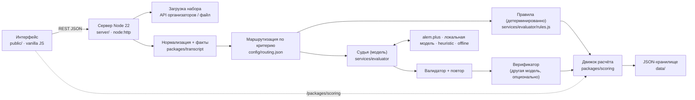

# Revengers CQA — Conversation Quality Analytics

[](https://github.com/advertising20240-hiii/Revengers-Data-Challenge/actions/workflows/ci.yml)


[](LICENSE)

Автоматическая, **объяснимая** и **оспариваемая** оценка качества диалогов поддержки по настраиваемому чек-листу. Прототип для NU Data Challenge × Freedom Broker (кейс «Conversation Quality Analytics»). RU · KZ · EN, чаты и звонки. Репозиторий: <https://github.com/advertising20240-hiii/Revengers-Data-Challenge>.

> Каждый балл — аргумент: правило чек-листа, реплики-доказательства, проверенный участок, уверенность. Его можно оспорить, проверяющий решает, система пересчитывает — и согласие с человеком измерено, а не обещано.

[English section below](#english)

---

## Содержание

1. [Что это](#что-это)
2. [Быстрый старт](#быстрый-старт)
3. [Как пользоваться](#как-пользоваться)
4. [Архитектура](#архитектура)
5. [Модели, маршрутизация и стоимость](#модели-маршрутизация-и-стоимость)
6. [Калибровка](#калибровка)
7. [Тесты и CI](#тесты-и-ci)
8. [Безопасность](#безопасность)
9. [Dynamics 365](#dynamics-365)
10. [Ограничения](#ограничения)
11. [Команда и лицензия](#команда-и-лицензия)

## Что это

| Контур | Что умеет |
|---|---|
| **Чек-лист** | Редактор критериев: текст, секция, вес, тип ответа (Да/Нет · Да/Нет/N/A · шкала со ступенями · флаг без баллов), доступность и условие N/A, подсказки модели по критерию и по каждому ответу. 6 шаблонов (в т. ч. детерминированное правило «Скорость первой реакции»). **Версии** (сохранить, активировать, diff, восстановить), **замена критерия**, **симуляция** черновика на N диалогах без записи. Новый критерий применяется через настройки, без кода. |
| **Оценка** | Загрузка набора по `group_id` через API организаторов (с кэшем), загрузка/вставка JSON того же формата. Оценка одного диалога или всех — с прогрессом, отменой, возобновлением. Оценивается **только оператор**; бот и системные события — контекст. |
| **Результат** | По критерию: ответ, баллы, вес и **эффективный вес** после перераспределения, объяснение на русском, реплики-доказательства с цитатой и ссылкой, **проверенный участок** для «Нет», **причина N/A**, применённое правило, уверенность, источник решения (модель / правило / проверяющий). Итог, секции, флаг грубой ошибки с типом. Модель, версия промпта, задержка. |
| **Карточка** | Транскрипт и результат рядом; клик по доказательству подсвечивает реплику; для звонков — перемотка аудио. Deep link `#/c/<id>/l/<строка>`. Переключатель версий чек-листа. |
| **Апелляция** | Оператор оспаривает критерий с комментарием → статус «под апелляцией» везде, исходная оценка видна. Проверяющий видит спор, доказательства, фрагмент; опционально — «второе мнение» модели (рекомендация, не решение). |
| **Решение** | Подтвердить/изменить с обоснованием; четыре исхода (балл изменён · критерий нужно менять · верно, пробел в объяснении · верно, коучинг). Пересчёт общим движком; история «исходная → решение → финал». Спорные оценки исключены из рейтингов операторов. |
| **Калибровка** | Согласие модели с человеческими метками на 65 DEV-диалогах: точность и κ Коэна по критериям с 95 % ДИ, отдельно на отложенной выборке (20 диалогов), матрицы ошибок, список расхождений со ссылками на диалоги, полнота/точность по грубым ошибкам. |
| **Инсайты** | Распределение итогов, доля провалов по критерию, язык/канал, эскалации, время первой реакции, удержание в звонках, список грубых ошибок, карточки операторов. Экспорт CSV. |

Формула — из чек-листа организаторов, один в один: Да = полный вес, Нет = 0, шкала пропорционально; N/A исключается, веса перераспределяются; округление до двух знаков точной арифметикой (`60.5 / 80 → 75.63`); грубая ошибка — отдельный флаг, итог не меняет (в DEV есть диалог `p1-ru-023` с итогом 100.00 и флагом «обход компании»). Подробно — [docs/SCORING_POLICY.md](docs/SCORING_POLICY.md).

## Быстрый старт

Нужны Node.js ≥ 22.5 и git. Внешних npm-зависимостей **нет** — `npm install` ничего не скачивает.

```bash
git clone https://github.com/advertising20240-hiii/Revengers-Data-Challenge.git
cd Revengers-Data-Challenge
npm install            # зависимостей нет; завершается мгновенно
npm start              # → http://localhost:8080
```

**Без ключей и без сети** приложение работает сразу: при первом запуске сервер устанавливает чек-лист v1 (`config/checklist.v1.json`), загружает DEV-набор из `data/dev/DEV.json` (65 диалогов) и 65 сохранённых оценок из `data/seed/DEV.evaluations.json`. Все карточки, доказательства, апелляции, калибровка и инсайты доступны; новые оценки запускать нельзя (баннер «Модель недоступна»). Проверить: `npm test` и `curl http://localhost:8080/api/health` (ожидается `"counts":{"conversations":65,"evaluations":65,...}`).

**Для живой оценки** скопируйте `.env.example` в `.env` и выберите бесплатный провайдер:

- **alem.plus** (основной): `ALEM_BASE_URL`, `ALEM_API_KEY` и идентификаторы моделей `ALEM_MODEL_JUDGE` (судья), `ALEM_MODEL_VERIFIER`, `ALEM_MODEL_KZ`, `ALEM_MODEL_FALLBACK` из списка моделей платформы.
- **Ollama локально** (данные не покидают машину): `ollama pull qwen2.5:7b`, `ollama serve`; остальное уже в `.env.example`.

`CQA_PROVIDER` пустой = автоматически alem → ollama → offline. Платные облачные провайдеры заблокированы (`CQA_ALLOW_CLOUD=0`). Все переменные с комментариями — в [.env.example](.env.example).

## Как пользоваться

### Загрузить набор (DEV / контрольный)
«Диалоги» → **«Загрузить набор»** → `group_id` (`DEV` или контрольный от организаторов) → данные приходят через сервер (API организаторов не допускает запрос из браузера) и кэшируются в `data/raw/<group_id>.json`. Альтернативы: **«Загрузить файл»** / вставить JSON в формате API. Из командной строки:

```bash
curl -X POST localhost:8080/api/datasets/fetch -H 'Content-Type: application/json' -d '{"group_id":"DEV"}'
```

### Оценить
«Диалоги» → **«Оценить все»** или выбрать строки → **«Оценить выбранные»** (прогресс, отмена, возобновление; частичные результаты видны сразу; уже оценённые критерии берутся из кэша). CLI: `npm run evaluate -- --group DEV`.

### Прочитать результат
Карточка `#/c/<id>`: слева транскрипт с номерами строк, справа итог, секции и критерии. «Доказательство» → подсветка строки (для звонка — перемотка аудио). «Проверенный участок» у «Нет», «Условие N/A» у N/A, «Правило», «Уверенность». Ссылка на строку: `#/c/p1-ru-003/l/14`.

### Оспорить и решить
Роль **«Оператор»** (шапка) → критерий → **«Оспорить»** → комментарий → **«Отправить апелляцию»**. Роль **«Проверяющий»** → `#/appeals` → **«Принять решение»** → «Подтвердить оценку» или «Изменить значение» + исход + обоснование → **«Сохранить решение»** → «Итог до → после», история в карточке. Подробно — [docs/APPEALS.md](docs/APPEALS.md).

### Изменить чек-лист, симуляция, версии, замена критерия
`#/checklist`: редактировать/добавить критерий, взять шаблон или **«Заменить»** критерий (сценарий контрольной проверки) → версия-черновик → **«Симуляция на N диалогах»** (без записи) → **«Сохранить и применить к выбранным»**: сохранить версию, активировать, оценить выбранные — модель вызывается только для изменённых критериев (кэш по критерию), в карточке видно «кэш: N критериев, в модель: M». Diff между версиями, восстановление любой, переключатель версий в карточке.

## Архитектура



Один процесс, JSON-файлы, общий движок расчёта в браузере и на сервере, кэш судьи по критерию (ключ — хэш строк диалога, определения критерия, политики, версии промпта и модели), версии чек-листа, симуляция, фоновые задания. Подробно — [docs/ARCHITECTURE.md](docs/ARCHITECTURE.md); схемы данных — [schemas/](schemas/).

## Модели, маршрутизация и стоимость

| Роль | Модель в опубликованном прогоне | Переменная |
|---|---|---|
| Судья | alem.plus · `qwen3-8` | `ALEM_MODEL_JUDGE` |
| Верификатор (другое семейство) | alem.plus · `gpt-oss` — настроен; в продукте вызывается только для результатов с уверенностью < 0.75 (`CQA_VERIFY=low`); в опубликованном прогоне DEV выключен (0 вызовов), его вклад в точность не измерен | `ALEM_MODEL_VERIFIER`, `CQA_VERIFY` |
| Казахское второе мнение | alem.plus · `kazllm` — 15 вызовов (по одному на KZ-диалог); расходилось с судьёй в 9 из 15 — расхождение снижает уверенность и отправляет карточку на проверку | `ALEM_MODEL_KZ` |
| Резерв при 429/квоте | alem.plus · AlemLLM — автоматически при остатке ≤ 20 % лимита | `ALEM_MODEL_FALLBACK` |
| Локальная модель | Ollama / любой OpenAI-совместимый сервер — поддерживается конфигурацией; на машине разработки не установлена, качество не измерено | `OPENAI_BASE_URL`, `OPENAI_MODEL` |
| Без модели | `CQA_PROVIDER=heuristic` — правила по всем критериям; `offline` — только сохранённые результаты | `CQA_PROVIDER` |
| Платные облачные (заблокированы) | `CQA_MODEL` / `CQA_VERIFIER_MODEL` | `CQA_ALLOW_CLOUD=1` |

**Гибридная маршрутизация** ([config/routing.json](config/routing.json)): для каждого критерия источник решения выбран по измеренной точности на tune-разбиении (45 диалогов): **02** — правило, но «Нет» модели перекрывает «Да» правила; **03** и **07** — детерминированное правило по фактам транскрипта (событие подтверждения личности, события завершения), ответ модели сохраняется как второе мнение; **01, 04, 05, 06, 08** — модель. На всех 65 диалогах это подняло точность 02 с 46.2 % (только модель) до 89.2 %, 03 — с 15.4 % до 95.4 %, 07 — с 76.9 % до 93.8 %; ошибка итогового балла (MAE) — 6.41 против 18.24 у модели одной и 12.75 у правил одних. Маршрутизация выбиралась на tune-разбиении, поэтому честная оценка — отложенная выборка: там гибрид даёт MAE 6.93 против 17.58 / 14.88 (раздел «Три источника решения» в [reports/calibration.md](reports/calibration.md), методика — [docs/EVALUATION.md](docs/EVALUATION.md)). Маршрутизация действует только пока определение критерия не изменено: новый или отредактированный критерий всегда оценивает модель.

**Стоимость одной оценки: 0 ₸** — бесплатный API alem.plus либо локальная модель. Измерено на полном прогоне DEV (`reports/runs/alem_qwen3-8.json`): 138 вызовов на 65 диалогов (64 судья, 59 повторных запросов после валидатора, 15 казахская модель), 545 с стены при параллелизме 3 (≈ 8.4 с на диалог пропускной способности; 21.8 с задержка одного диалога), ≈ 10.8 тыс. входных и 2.6 тыс. выходных токенов на диалог. Ограничение — не деньги, а квота бесплатного API (заголовки показывали 200 запросов на окно неизвестной длины), поэтому кэш по критерию, один вызов судьи на диалог и не более одного повтора. Расчёт «если бы это был платный провайдер» (явно помеченная оценка, не факт) — в [docs/COST.md](docs/COST.md). Температура 0; модель, версия промпта и хэш политики записаны в каждом результате.

## Калибровка

```bash
npm run calibrate      # сравнивает сохранённые оценки с эталонными метками tests/gold/dev_labels.json
```

Эталонные метки **подготовлены командой** (один разметчик, с перечнем допустимых альтернатив для спорных случаев), не организаторами; второго разметчика нет. Отчёт — [reports/calibration.md](reports/calibration.md) (и `reports/calibration.json` для страницы `#/calibration`), методика — [docs/EVALUATION.md](docs/EVALUATION.md). Главные числа текущего отчёта (65 DEV-диалогов, судья `qwen3-8`, чек-лист v1, промпт `judge-v1.0`):

| Что | Значение |
|---|---|
| Точность по бинарным критериям 01 / 03 / 05 / 07 / 08 | 98.5 % / 95.4 % / 96.9 % / 93.8 % / 98.5 % (цель ≥ 92 %); **02 — 89.2 %, ниже цели** |
| Шкалы 04 / 06 | точно 84.6 % / 75.4 %; в пределах ±1 ступени 95.4 % / 98.5 %; κ 0.415 / **0.234** — слабое место, честно показано |
| Грубые ошибки (08) | полнота 100 % (8 из 8), точность 88.9 % (1 ложный флаг — `p4-ru-003`) |
| Итоговый балл | точное совпадение 52.3 %, средняя абсолютная ошибка 6.41 балла |
| По языкам (все метки) | RU 90.7 % · KZ 93.3 % · EN 91.7 % |

Эталонные метки используются для измерения и для выбора источника решения по критерию в `config/routing.json` (на tune-разбиении; отложенная выборка в отчёте отдельно). В промпты модели метки не попадают; «согласие с человеком» означает согласие с этой разметкой ([docs/LIMITATIONS.md](docs/LIMITATIONS.md)). Что **не** измерено: тест–ретест модели (`--retest N`, повтор измерен только для правил); устойчивость модели к инструкциям внутри транскрипта — есть архитектурная защита (транскрипт в блоке `untrusted`, строгая схема, валидатор, итог считает движок) и тест валидатора на подставном провайдере, но живого теста на модели нет; цикл обучения — реализован (подтверждённые решения проверяющего становятся примерами в промпте), его эффект не измерен (`learning_loop: null`, решений пока нет).

## Тесты и CI

```bash
npm test               # node --test: движок расчёта (вектор 60.5/80 → 75.63, эталонный итог каждого gold-диалога),
                       # нормализация и факты, схемы, сборка D365, аудит репозитория, сервер, оценщик
npm run audit          # scripts/audit-repo.sh — секреты и пути перед push
npm run build:d365     # dist/d365/cqa.html
```

CI (GitHub Actions, Node 22): тесты → аудит → сборка D365. Статус — бейдж вверху.

## Безопасность

Маски персональных данных из источника сохраняются как есть; аудио модели не передаётся; хранилище локальное; транскрипт подаётся модели как недоверенные данные, ответ проверяет детерминированный валидатор (строки существуют, N/A разрешён, ступень в шкале, у «Нет» есть участок); секреты только через `.env`; аудит перед push. Результаты поддерживают коучинг и проверку человеком и не предназначены для автоматических кадровых решений; эмоции не выводятся. Роли «Оператор / Проверяющий» — переключатель интерфейса (авторизация не требуется по условиям задания; для продуктива — роли безопасности Dynamics 365). Подробно — [docs/SECURITY.md](docs/SECURITY.md).

## Dynamics 365

```bash
npm run build:d365     # → dist/d365/cqa.html — один файл, < 5 МБ, относительные пути, хук Xrm
```

Веб-ресурс — только интерфейс: все данные он берёт из REST API по `apiBase` (параметр `data` при открытии или `window.CQA_CONFIG`), поэтому сервер `npm start` должен быть доступен. Таблицы Dataverse (чек-лист, критерий, оценка, результат критерия, апелляция), поток Power Automate для загрузки транскриптов, роли и соотношение с Quality Evaluation Agent — [docs/DYNAMICS365.md](docs/DYNAMICS365.md).

## Ограничения

Честный список — [docs/LIMITATIONS.md](docs/LIMITATIONS.md). Коротко: критерий 06 согласуется с человеком слабо (κ 0.23); 02 ниже цели; 92 % ответов судьи требуют одного повторного запроса после валидатора; эталон — 65 диалогов и один разметчик из команды; верификатор, тест–ретест модели, живой тест на инъекцию и эффект цикла обучения не измерены; дикция/интонация не оцениваются (нужен звук); авторизации нет; хранилище — файлы; решение Dataverse описано, не развёрнуто.

## Документация

| Файл | О чём |
|---|---|
| [docs/SCORING_POLICY.md](docs/SCORING_POLICY.md) | правила по критериям, N/A, формула, пример 75.63 |
| [docs/APPEALS.md](docs/APPEALS.md) | апелляции, статусы, четыре исхода, метрики споров |
| [docs/ARCHITECTURE.md](docs/ARCHITECTURE.md) | конвейер, модель данных, версии и кэш, симуляция |
| [docs/DYNAMICS365.md](docs/DYNAMICS365.md) | веб-ресурс, Dataverse, Power Automate, роли, QEA |
| [docs/SECURITY.md](docs/SECURITY.md) | данные, модель угроз, правила использования |
| [docs/RESEARCH.md](docs/RESEARCH.md) | аналоги и журнал источников |
| [docs/TOOLING.md](docs/TOOLING.md) | зависимости (их нет) и инструменты |
| [docs/DEMO.md](docs/DEMO.md), [docs/CONTROL_DAY.md](docs/CONTROL_DAY.md) | сценарий демонстрации с точными числами, runbook контрольного дня |
| [docs/COST.md](docs/COST.md), [reports/calibration.md](reports/calibration.md) | измеренная стоимость/задержка; отчёт калибровки |
| [docs/UX.md](docs/UX.md), [CHANGELOG.md](CHANGELOG.md) | дизайн интерфейса; изменения |

## Команда и лицензия

Команда **«Revengers»** — NU Data Challenge «Doomsday», 7–8 ноября 2026, Астана.

<!-- team: fill names -->
| Роль | Участник |
|---|---|
| Капитан / спикер | — |
| Backend и оценщик | — |
| Frontend | — |
| Данные и калибровка | — |

Лицензия [MIT](LICENSE) © 2026 Revengers team.

---

<a id="english"></a>
# English

**Revengers CQA** is a Conversation Quality Analytics prototype built for the NU Data Challenge × Freedom Broker case: automatic, explainable and disputable evaluation of support operators against a configurable checklist, in Russian, Kazakh and English, for chats and voice calls. Repository: <https://github.com/advertising20240-hiii/Revengers-Data-Challenge>.

Every score is an argument you can audit: the checklist rule applied, the evidence lines with verbatim quotes, the checked range for a "No", the reason for an N/A, a confidence value and the decision source (model, deterministic rule or reviewer). Operators can dispute any criterion, an independent reviewer decides with one of four outcomes, the shared scoring engine recomputes the total, and the Calibration page shows how well the model agrees with human labels instead of promising it.

### Features

- **Checklist editor** — criteria with text, section, weight, answer type (Yes/No, Yes/No/N/A, stepped scale, flag-only), N/A availability and condition, criterion- and answer-level guidance for the model; 6 templates (including a deterministic "first reaction time" rule); **versions** (save, activate, diff, restore), **replace criterion**, **simulation** of a draft on N dialogs without touching stored results. New criteria apply through configuration, no code.
- **Evaluation** — fetch a dataset by `group_id` through the organizers' API (server-side, cached), or upload/paste JSON in the same format; evaluate one dialog or all with progress, cancel and resume. Only operator lines are judged; bot and system lines are context.
- **Result** — per criterion: answer, points, weight and effective weight after N/A redistribution, Russian explanation, evidence lines, checked range, N/A reason, rule applied, confidence, source; total, section subtotals, gross-error flag with type (insult / bypass / disclosure) kept separate from the score (DEV dialog `p1-ru-023` scores 100.00 and carries a bypass flag); model, prompt version and latency.
- **Dialog card** — transcript and result side by side, click-to-highlight evidence, audio seek for calls, shareable deep links `#/c/<id>/l/<line>`, checklist-version switcher.
- **Appeals and review** — operator disputes a criterion; the evaluation is marked "under appeal" everywhere and excluded from operator rankings; the reviewer sees the dispute, evidence and fragment, optionally an advisory AI second opinion, and confirms or changes with a reason and one of four outcomes; history is kept.
- **Calibration and insights** — agreement with human labels on the 65 DEV dialogs (accuracy and Cohen's κ per criterion with 95 % CIs, a 20-dialog holdout, confusion matrices, disagreement list with dialog links, gross-error recall/precision); dataset analytics (score distribution, fail rate per criterion, escalation, first-reaction times, hold time, gross-error list, operator cards); CSV export.

### Quick start

```bash
git clone https://github.com/advertising20240-hiii/Revengers-Data-Challenge.git
cd Revengers-Data-Challenge
npm install            # zero dependencies — completes instantly
npm start              # → http://localhost:8080
```

**No key, no network needed**: on first start the server installs checklist v1, loads the bundled DEV dataset (`data/dev/DEV.json`, 65 dialogs) and the 65 committed evaluations (`data/seed/DEV.evaluations.json`). Cards, evidence, appeals, calibration and insights all work; only new evaluations are disabled (an "evaluator unavailable" banner). For live evaluation copy `.env.example` to `.env` and configure a free provider: **alem.plus** (`ALEM_BASE_URL`, `ALEM_API_KEY`, `ALEM_MODEL_*`) or **Ollama** locally (`ollama pull qwen2.5:7b`). Provider selection is automatic (alem → ollama → offline); paid cloud providers are locked behind `CQA_ALLOW_CLOUD=1`.

### Models, routing and cost

Published DEV run: judge `qwen3-8` on alem.plus; Kazakh second opinion `kazllm` (one extra call per KZ dialog; disagreed with the judge on 9 of 15, which lowers confidence and routes the card to review); verifier `gpt-oss` configured — in the product it runs only for results with confidence < 0.75 (`CQA_VERIFY=low`), in the published run it was off and its contribution is unmeasured; fallback AlemLLM (automatic at ≤ 20 % of the quota); a local OpenAI-compatible model (e.g. Ollama) is supported by configuration but was not installed or measured; `CQA_PROVIDER=heuristic` runs every criterion as deterministic rules with no model. **Hybrid routing** ([config/routing.json](config/routing.json)) picks the decision source per criterion from measured tune-split accuracy: criteria 03 and 07 are decided by deterministic transcript facts (the model's answer is kept as a second opinion), 02 by a rule that a model "No" can override, 01/04/05/06/08 by the model. On all 65 dialogs this lifted accuracy on 02 from 46.2 % (model only) to 89.2 %, on 03 from 15.4 % to 95.4 %, on 07 from 76.9 % to 93.8 %, and cut the total-score MAE to 6.41 points (model only 18.24, rules only 12.75); on the untouched 20-dialog holdout the hybrid MAE is 6.93 vs 17.58 / 14.88 ([docs/EVALUATION.md](docs/EVALUATION.md)). Any new or edited criterion is always judged by the model.

**Cost per evaluation: 0 ₸** — free API or local model. Measured on the full DEV run (`reports/runs/alem_qwen3-8.json`): 138 calls for 65 dialogs (64 judge, 59 validator repairs, 15 Kazakh), 545 s wall at concurrency 3 (≈ 8.4 s per dialog throughput, 21.8 s mean per-dialog latency), ≈ 10.8k input / 2.6k output tokens per dialog. The binding constraint is the free API's request quota (headers showed 200 requests per unknown window), not money — hence the per-criterion cache, one judge call per dialog and at most one repair. The explicitly labelled *estimate* of what a paid provider would cost is in [docs/COST.md](docs/COST.md). Temperature 0; model, prompt version and policy hash are recorded on every result.

### Calibration headline numbers

Gold labels were **prepared by the team** (one annotator with accepted alternatives for borderline cases), not by the organizers. From [reports/calibration.md](reports/calibration.md) (65 DEV dialogs): binary criteria 01 / 03 / 05 / 07 / 08 at 98.5 / 95.4 / 96.9 / 93.8 / 98.5 % accuracy, **02 at 89.2 % (below the 92 % target)**; scales 04 / 06 exact 84.6 / 75.4 %, within one step 95.4 / 98.5 %, κ 0.415 / **0.234 (weak, shown honestly)**; gross-error recall 100 % (8/8), precision 88.9 %; exact total match 52.3 %, MAE 6.41 points; by language RU 90.7 %, KZ 93.3 %, EN 91.7 %. Not measured: model test–retest (only the rules were re-run), a live prompt-injection test on the model (there is an `untrusted` transcript block, a strict schema, the validator and a validator test with a fake provider), and the effect of the learning loop (implemented — confirmed reviewer decisions become few-shot examples — but no decisions exist yet).

### Scoring

Exactly the organizers' checklist formula: Yes = full weight, No = 0, scale = step / max × weight; N/A criteria are excluded and their weight redistributed; rounded half away from zero to two decimals with exact rational arithmetic (`60.5 / 80 → 75.63`); gross errors are a separate flag that never changes the total. Policy: [docs/SCORING_POLICY.md](docs/SCORING_POLICY.md) (Russian).

### Tests, CI, audit, Dynamics 365

`npm test` (scoring incl. the expected total of every gold dialog, transcript facts, schemas, D365 build, repository audit, server, evaluator) · `npm run audit` (secret and path scan before push) · `npm run build:d365` → `dist/d365/cqa.html`, a single-file HTML web resource under 5 MB with relative paths and an `Xrm` client-URL hook; it is UI only and talks to the REST API at `apiBase`, so the server must be reachable. GitHub Actions runs all three on Node 22. Dataverse table mapping, Power Automate ingestion flow, roles and the relationship to Microsoft's Quality Evaluation Agent (we complement and map to it, not replace it): [docs/DYNAMICS365.md](docs/DYNAMICS365.md).

### Security and usage

PII masks from the source are preserved; no audio is sent to the model; storage is local; transcripts are treated as untrusted data and every answer passes a deterministic validator; secrets only via `.env`. Roles (operator / reviewer) are a UI switch, as the task allows; production needs real authorization. Results support coaching and human review — never automatic employment decisions; no emotion inference. Details: [docs/SECURITY.md](docs/SECURITY.md). Limitations: [docs/LIMITATIONS.md](docs/LIMITATIONS.md).

### Team and license

Team **Revengers**, NU Data Challenge "Doomsday", Astana, 7–8 November 2026. <!-- team: fill names --> MIT License © 2026 Revengers team.
