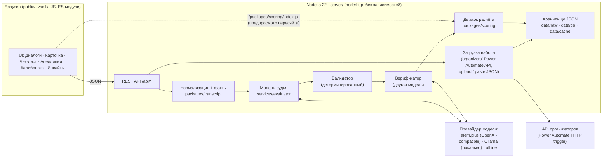
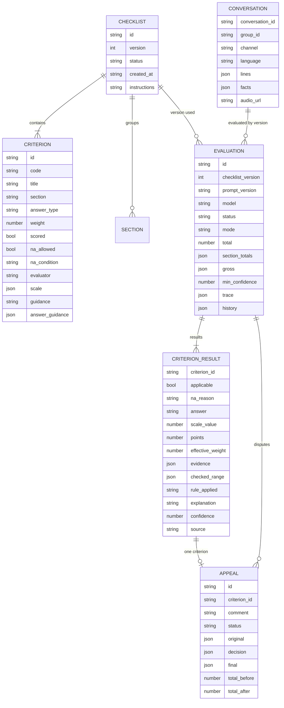

# Архитектура

Revengers CQA — один процесс Node.js (`npm start`), который отдаёт интерфейс и REST API, хранит данные в JSON-файлах под `data/` и вызывает модель-судью через OpenAI-совместимый API. Внешних npm-зависимостей нет.

## 1. Общая схема

Поток оценки одного диалога (на одну версию чек-листа):

1. **Нормализация** — пронумерованные строки `[#12 03:58 operator] текст`, `offset_seconds` от первой реплики, язык клиента, имя оператора, сегменты (бот → оператор; удержание/консультация в звонках).
2. **Факты (детерминированно)** — первая реплика оператора и признаки приветствия/имени, строка подтверждения личности, первый кандидат на раскрытие до подтверждения, события завершения, последняя реплика оператора, предупреждения об ожидании, сигналы жалоб, лексика оскорблений/обхода компании, время первой реакции. Лексиконы по языкам — `config/lexicon/*.json`. Критерии с `evaluator: "rule:<name>"` решаются здесь полностью, без модели.
3. **Судья (модель)** — system: чек-лист из конфигурации + политика (`docs/SCORING_POLICY.md`) + JSON-схема ответа + защита от инструкций в транскрипте; user: факты + пронумерованный транскрипт. Ответ по каждому критерию: применимость, причина N/A, ответ/ступень, доказательства `{line, why}`, проверенный участок, применённое правило, объяснение на русском, уверенность. До 5 подтверждённых решений проверяющего по критерию добавляются как примеры (цикл обучения).
4. **Валидатор** — строки-доказательства существуют; N/A только где разрешён; ступень ∈ шкале; у «Нет» есть проверенный участок; 01 ссылается на первую реплику оператора; 03 = Да требует подтверждения до раскрытия. При нарушении — один повторный запрос со списком проблем, затем консервативный ответ с `confidence ≤ 0.5`.
5. **Верификатор** — модель другого семейства проверяет судью по правилам и фактам; исправления с причинами сохраняются в `trace.verifier_changes`; расхождение снижает уверенность.
6. **Движок расчёта** — баллы, эффективные веса, итог, секции, флаги грубых ошибок. Точная рациональная арифметика (BigInt), округление половины от нуля. Один и тот же модуль работает на сервере, в CLI и в браузере.
7. **Сохранение** `Evaluation` с `trace` (версия и хэш промпта, модель, токены, стоимость, задержка). `confidence < 0.6` → метка «Требует проверки» и очередь проверяющего.

## 2. Роли моделей

| Роль | Назначение | По умолчанию | Переменная |
|---|---|---|---|
| Судья | основная оценка по всем критериям | alem.plus, модель семейства Qwen 3.8 | `ALEM_MODEL_JUDGE` |
| Верификатор | аудит судьи **другим семейством моделей**, чтобы не наследовать его систематические ошибки | alem.plus, GPT-OSS или Gemma 4 | `ALEM_MODEL_VERIFIER` |
| Казахское второе мнение | дополнительное мнение по KZ-диалогам | alem.plus, KazLLM | `ALEM_MODEL_KZ` |
| Запасной | когда судья недоступен | alem.plus, AlemLLM | `ALEM_MODEL_FALLBACK` |
| Локальный последний резерв | полностью офлайн, данные не покидают машину | Ollama `qwen2.5:7b` | `OLLAMA_BASE_URL`, `OPENAI_MODEL` |
| Платные облачные | заблокированы `CQA_ALLOW_CLOUD=0` | `claude-sonnet-5-5` / `claude-haiku-5-5` | `CQA_MODEL`, `CQA_VERIFIER_MODEL` |

Выбор провайдера: `CQA_PROVIDER` пустой = автоматически alem → ollama → offline (только кэш). Фактические измеренные задержки и токены — в `docs/COST.md`.

## 3. Модель данных

Схемы — `schemas/*.json` (JSON Schema 2020-12), проверяются тестом `tests/build.test.js`.

- `Conversation` — запись API организаторов как есть + `group_id`, `lines[]`, `facts`.
- `Evaluation` хранится **на пару (диалог, версия чек-листа)**; `mode: 'simulation'` не сохраняется.
- `CriterionResult.source`: `ai` (судья), `rule` (детерминированное правило), `review` (решение проверяющего); исходный ответ модели остаётся в `ai_original`.
- `Appeal.decision.outcome` — одна из четырёх таксономий (`docs/APPEALS.md`).

Хранение: `data/raw/<group_id>.json` (ответ API), `data/db/*.json` (оценки, апелляции, версии чек-листа; атомарная запись через временный файл), `data/cache/eval/` (кэш судьи по критериям).

## 4. Версии и кэш

- Чек-лист **версионируется**: сохранение создаёт `version = max + 1` со статусом `draft`; `activate` делает активной; `diff` показывает добавленные/удалённые/изменённые критерии по полям; `restore` создаёт новую активную версию из старой. Удаления нет — только архив.
- **Кэш судьи по критерию**: ключ = хэш(строки диалога, JSON определения критерия, политика, `PROMPT_VERSION`, модель). Изменили формулировку одного критерия → при применении новой версии модель вызывается **только для него**; остальные берутся из кэша. Это делает замену критерия на контрольном наборе быстрой и дешёвой.
- Каждый результат несёт `prompt_version` и `prompt_hash`: смена промпта или модели видна в данных и требует перекалибровки.

## 5. Симуляция

`POST /api/simulate {checklist, conversation_ids}` прогоняет черновик чек-листа (или один новый критерий) на выбранных диалогах **без сохранения**: результат — полные `Evaluation` в `mode:'simulation'` плюс сравнение с сохранённой оценкой активной версии (`simulated_total`, `stored_total`, `changed_criteria`). Так проверяют новую формулировку до публикации версии.

## 6. Как добавить критерий без кода

1. На странице «Чек-лист» → «Добавить критерий» (или из шаблонов: скорость первой реакции, обращение по стандарту, предложение помощи, точность информации, конфиденциальность, проверка понимания).
2. Заполнить: название, секцию, вес, тип ответа (`yes_no`, `yes_no_na`, `scale`, `scale_na`, `flag`), ступени шкалы, доступность и условие N/A, определение, подсказки для модели — общую и по каждому ответу.
3. Выбрать исполнителя: `llm` (модель) или `rule:<name>` для детерминированных правил (например, `rule:first_reaction` с `params.threshold_seconds`).
4. «Симуляция на N диалогах» → посмотреть разницу → «Сохранить версию» → «Активировать» → «Применить к выбранным».

Промпт судьи рендерится из конфигурации: новое определение, шкала и подсказки попадают в него автоматически. Схема ответа модели тоже строится из конфигурации, поэтому валидатор сразу знает допустимые ступени и возможность N/A.

## 7. Фоновые задания

`POST /api/evaluate` и `/api/simulate` создают задание (`job`) с прогрессом, отменой и возобновлением; частичные результаты видны сразу. Параллелизм — `CQA_CONCURRENCY`.

## 8. Интерфейс

Vanilla JS, hash-маршруты (`#/`, `#/c/<id>`, `#/c/<id>/l/<line>`, `#/checklist`, `#/appeals`, `#/calibration`, `#/insights`), монтирование в `
`, CSS под `.cqa-root`, конфигурация `window.CQA_CONFIG = {apiBase, lang}`. Только статические относительные импорты и именованные экспорты — это условие сборки в один HTML-файл для Dynamics 365 (`docs/DYNAMICS365.md`). Графики — собственный inline SVG. Аудио — нативный `<audio>` с переходом к `offset_seconds` реплики.
