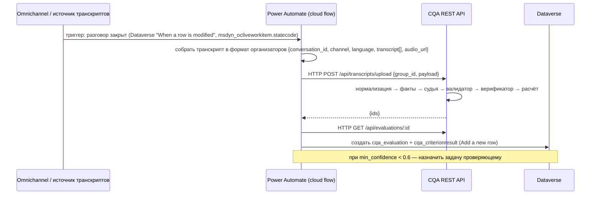

# Путь в Dynamics 365 / Power Platform

Freedom работает на Dynamics 365 с Power Automate: сам API организаторов — HTTP-триггер Power Automate. Задание требует интерфейс на HTML/CSS/JS, который можно адаптировать как HTML-компонент Dynamics 365. Этот документ описывает, как Revengers CQA ложится на платформу: сборка веб-ресурса, таблицы Dataverse, поток загрузки транскриптов, роли и соотношение с Quality Evaluation Agent от Microsoft.

Факты о платформе ниже взяты из документации Microsoft Learn (проверено 2026-11-07); ссылки — в `docs/RESEARCH.md`.

## 1. HTML-веб-ресурс: один файл

`npm run build:d365` → `dist/d365/cqa.html` (`scripts/build-d365.mjs`).

Ограничения веб-ресурсов Dataverse и как сборка их выполняет:

| Требование платформы | Как выполнено |
|---|---|
| Только статические файлы (HTML/CSS/JS/изображения), без серверного кода | один HTML-файл; все вызовы идут в REST API по `apiBase` |
| Лимит загрузки по умолчанию 5 МБ (`Organization.MaxUploadFileSize`) | сборка завершается ошибкой при размере ≥ 5 МБ и печатает размер |
| Относительные пути; абсолютные `/WebResources/<имя>` недопустимы | все CSS, JS и JSON-ресурсы **встроены**; сборка проверяет отсутствие `/WebResources/` |
| Классический `<script>` (модули и `import.meta` в веб-ресурсе ненадёжны) | ES-модули переписываются в реестр функций внутри одного `<script>`; `import.meta.url` заменяется на идентификатор модуля |
| Контекст организации | `Xrm.Utility.getGlobalContext().getClientUrl()` читается при наличии `Xrm` (в т. ч. из `parent`) и сохраняется в `CQA_CONFIG.clientUrl` |
| Передача параметров при открытии | `Xrm.Navigation.openWebResource(webResourceName, windowOptions, data)` — строковый параметр `data` принимается как JSON (`{"apiBase":"https://cqa.internal.example"}`) или как строка-URL и попадает в `window.CQA_CONFIG.apiBase` |
| Объект `Xrm` недоступен внутри HTML-веб-ресурса напрямую | хук читает `parent.Xrm` (работает в контейнере формы); при открытии из карты сайта `apiBase` передаётся через `data`, а контекст при необходимости — через `ClientGlobalContext.js.aspx` / `GetGlobalContext()` |

Порядок внедрения: Решение (solution) → Веб-ресурс типа «Веб-страница (HTML)», имя `<префикс издателя>_/cqa/cqa.html` → публикация → открытие из кнопки ленты / карты сайта (`$webresource:<имя>`) или из формы Dataverse через `openWebResource` с `data`. Для более глубокой интеграции (контролы на формах, доступ к контексту записи) следующий шаг — PCF-контрол или настраиваемая страница (custom page) с тем же кодом интерфейса.

Что остаётся снаружи: REST API и хранилище. Варианты размещения — Azure App Service / контейнер / внутренняя ВМ; `apiBase` указывает на него. В прототипе сервер — `npm start` на одной машине.

Условия, которым следует код интерфейса (проверяются сборкой): только статические относительные импорты и `/packages/...`, именованные экспорты, без динамического `import()` и top-level await; `window.CQA_CONFIG` остаётся переопределяемым.

## 2. Таблицы Dataverse (предлагаемое соответствие)

Префикс издателя условно `cqa_`. Соответствие объектам прототипа (`schemas/*.json`):

| Таблица Dataverse | Объект прототипа | Ключевые столбцы |
|---|---|---|
| `cqa_checklist` | `Checklist` | `cqa_name`, `cqa_version` (целое), `cqa_status` (выбор: draft/active/archived), `cqa_instructions` (многострочный), `cqa_createdon`; **логический ключ** `(cqa_checklistid, cqa_version)` |
| `cqa_criterion` | `Criterion` | поиск → `cqa_checklist`; `cqa_code`, `cqa_title`, `cqa_section`, `cqa_answertype` (выбор), `cqa_weight` (десятичное), `cqa_scored`, `cqa_naallowed`, `cqa_nacondition`, `cqa_definition`, `cqa_scalejson`, `cqa_evaluator`, `cqa_guidance`, `cqa_answerguidancejson` |
| `cqa_evaluation` | `Evaluation` | поиск → `cqa_checklist` (версия); поиск → разговор (`msdyn_ocliveworkitem` для Omnichannel-чата или собственная `cqa_conversation`); `cqa_total` (десятичное 2 знака), `cqa_calculated`, `cqa_status` (final/under_appeal/reviewed), `cqa_grossflag`, `cqa_grosstypes`, `cqa_minconfidence`, `cqa_model`, `cqa_promptversion`, `cqa_costusd`, `cqa_latencyms`, `cqa_tracejson` |
| `cqa_criterionresult` | `CriterionResult` | поиск → `cqa_evaluation`, поиск → `cqa_criterion`; `cqa_applicable`, `cqa_nareason`, `cqa_answer`, `cqa_scalevalue`, `cqa_points`, `cqa_effectiveweight`, `cqa_explanation`, `cqa_evidencejson` (строки + цитаты), `cqa_checkedfrom`, `cqa_checkedto`, `cqa_ruleapplied`, `cqa_confidence`, `cqa_source` (ai/rule/review) |
| `cqa_appeal` | `Appeal` | поиск → `cqa_evaluation`, поиск → `cqa_criterion`; `cqa_comment`, `cqa_status` (open/confirmed/changed), `cqa_outcome` (четыре исхода), `cqa_reviewernote`, `cqa_originaljson`, `cqa_finaljson`, `cqa_totalbefore`, `cqa_totalafter`, владелец = оператор, `cqa_reviewer` → `systemuser` |

Журнал `history` ложится на стандартный аудит Dataverse (включить аудит для `cqa_evaluation` и `cqa_appeal`) либо на отдельную `cqa_evaluationhistory`.

## 3. Загрузка транскриптов через Power Automate

API организаторов уже является HTTP-триггером Power Automate с параметром `group_id`. Поток для продуктивной среды:

Наоборот (как в хакатоне): поток Power Automate с HTTP-триггером отдаёт набор по `group_id`, а CQA его забирает `POST /api/datasets/fetch`. Оба направления используют один формат записи.

## 4. Роли

| Роль безопасности | Права |
|---|---|
| **CQA Operator** | чтение своих `cqa_evaluation`/`cqa_criterionresult`; создание `cqa_appeal` по своим оценкам |
| **CQA Reviewer** | чтение всех оценок и апелляций; **решение по апелляции** (изменение `cqa_appeal.status/outcome`, запись `cqa_criterionresult.source = review`) |
| **CQA Quality Manager** | всё выше + редактирование и активация версий `cqa_checklist`, переопределение завершённых оценок |

Это повторяет ролевую модель QEA (Quality Administrator / Quality Manager / Quality Evaluator): создавать критерии и планы могут администратор и менеджер, завершать или назначать оценку — все три. В прототипе роли — переключатель в интерфейсе (авторизация по условиям задания не требуется); в Dataverse они становятся ролями безопасности, а проверка выполняется на стороне платформы и API.

## 5. Соотношение с Quality Evaluation Agent (Microsoft)

Revengers CQA **дополняет и отображается на** QEA в Dynamics 365 Contact Center; он его не заменяет.

| QEA | Revengers CQA |
|---|---|
| Критерии → секции (веса в сумме 100 %) → вопросы 0–100 (Да/Нет, одиночный выбор с баллами, множественный, описательный) | Чек-лист → секции → критерии с **весами, Да/Нет/N/A, ступенчатыми шкалами и флагами** — формат чек-листа Freedom как есть |
| Критический вопрос: оценка «не пройдена», балл не меняется | Грубые ошибки: отдельный флаг с типами, итог не меняется — та же идея |
| Версии с восстановлением | Версии, diff, восстановление, **применение версии к выбранным диалогам с кэшем** |
| Симуляция черновика/опубликованных критериев на последних записях (по умолчанию 25) | Симуляция черновика на N выбранных диалогах со сравнением итогов с сохранённой оценкой |
| Инструкции на уровне критериев, вопроса и ответа; лимиты 50 вопросов / 2 000 символов на инструкцию | `instructions` чек-листа, `guidance` и `answer_guidance` на каждом критерии; `maxCriteria: 50` в конфигурации сервера |
| «Allow Not Applicable responses»: вопрос исключается, балл считается по применимым | N/A только там, где разрешён **и** выполнено условие; причина обязательна |
| Результаты на языке критериев; редактирование — Quality Manager/Admin | Объяснения на русском при RU/KZ/EN транскриптах; роли проверяющего/менеджера |
| Политика: «не предназначен для решений, влияющих на занятость сотрудников» | Та же политика; дополнительно явно: без вывода эмоций (`docs/SECURITY.md`) |
| — | **Веса критериев, Да/Нет/N/A и ступенчатые шкалы** в формате чек-листа Freedom, перераспределение весов по его формуле, точное округление половины от нуля |
| — | **Апелляция с четырьмя исходами**, исключение спорных оценок из рейтингов, метрики споров |
| — | **Калибровка против человеческих меток** (κ по критериям с доверительными интервалами) |
| — | Казахское второе мнение, модели Alem Plus по ключам хакатона (0 ₸ для команды) и локальные модели, измеренные задержки и токены |

Практический сценарий внедрения: QEA остаётся для стандартизированных оценок внутри Contact Center; CQA даёт команде качества Freedom чек-лист-нативный расчёт, апелляции и калибровку, а результаты пишутся в Dataverse рядом с записями разговоров, где их видят оба инструмента и отчёты Power BI.

## 6. Что не сделано в прототипе

- Нет развёрнутого решения Dataverse (таблицы описаны, не созданы).
- Нет PCF-контрола; веб-ресурс открывается как отдельная страница.
- Аутентификация API к Dataverse (Entra ID, OAuth) — на стороне размещения API, в прототипе отсутствует.
